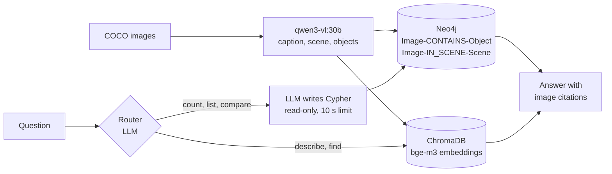

# multimodal-graph-rag

[](../../actions/workflows/ci.yml)

A multimodal Graph RAG that runs entirely on local models, measured against ground truth.
A vision-language model describes each photo; the descriptions feed a Neo4j graph (images,
objects, scenes) and a ChromaDB vector index; an LLM routes each question to the right
index, writes the Cypher query when needed, and answers with citations of the images it used.

The images and their annotations come from COCO 2017, so every stage can be scored: what the
VLM saw, which index a question went to, whether the LLM's query was right, and whether the
final count matches reality.


## Architecture



All models run through [Ollama](https://ollama.com): `qwen3-vl:30b` (vision), `mistral-small3.2`
(routing, Cypher, answers), `bge-m3` (embeddings). No external API.

Generated Cypher is checked before it runs (no `CREATE`, `MERGE`, `DELETE`, `SET`, `CALL`,
`LOAD CSV`...) and then executed in a **read transaction** with a 10 s timeout, so the database
itself refuses any write the check might miss.

## Results

500 COCO val2017 images (a seeded sample), all described. Full details in
[`results/`](results/).

| Stage | Metric | Result |
| --- | --- | ---: |
| VLM object extraction | precision / recall / F1 against COCO annotations (80 categories) | 0.86 / 0.90 / 0.88 |
| Router | questions sent to the right index (30 counting + 10 search) | 40 / 40 |
| LLM-written Cypher | counting answers equal to a reference query on the same graph | 29 / 30 |
| End to end | counting answers equal to the COCO count | 8 / 30 |
| End to end | counting answers within one image of the COCO count | 20 / 30 |
| End to end | median relative error of the count | 14 % |
| Semantic search | precision@5 (image relevant if COCO annotates the target object) | 0.90 |

Reading these numbers:

- **The LLM side is rarely the bottleneck.** Routing was right every time. One query of 30 was
  wrong: for "a orange and a person" the LLM bound both objects to the same variable `o`,
  asking for one node that is both, and got 0 instead of 3. All other counting errors come
  from the VLM's descriptions.
- **Extraction errors add up in aggregates.** With 88 % F1 per image, a count over a few dozen
  images is rarely exact: the median error is 14 %, more often too low (15) than too high (7).
  The objects the VLM misses most are `dining table`, `truck` and `handbag`, often partly
  visible or in the background.
- So a statistic computed from VLM-built graphs needs an uncertainty margin before it is
  reported to a user.
- **Keep the LLM's task small.** Asking it to return both the count and example image ids in
  one query made it write `UNION`s and undefined variables: 5 of the 30 queries failed. The
  prompt asks for the count only, and the query that fetches the images to cite is derived by
  code from the validated query (same `MATCH`, new `RETURN`).

## What I tried to improve extraction

The counting errors come from the VLM, so I tried other models and prompts. Protocol: every
variant is tuned on **100 development images**, disjoint from the 500 evaluation images
(`python -m mmgraphrag dev`), and only the retained variants are then run on the evaluation
images.

**Development images** ([`results/dev_comparison.json`](results/dev_comparison.json)):

| Vision model | Prompt | Precision | Recall | F1 | Images described |
| --- | --- | ---: | ---: | ---: | ---: |
| qwen3-vl:30b | v1 | 0.89 | 0.91 | **0.90** | 98 / 100 |
| qwen3-vl:8b | v1 | 0.88 | 0.89 | 0.88 | 86 / 100 |
| qwen3-vl:8b | v2: + one verification question | 0.90 | 0.88 | 0.89 | 85 / 100 |
| qwen3-vl:8b-instruct-q8_0 | v1 | 0.45 | 0.97 | 0.61 | 100 / 100 |
| qwen3-vl:8b-instruct-q8_0 | v2: + one verification question | 0.84 | 0.94 | 0.89 | 100 / 100 |
| qwen3-vl:8b-instruct-q8_0 | v3: + one yes/no question per object | 0.91 | 0.88 | 0.89 | 100 / 100 |
| gemma3:12b | v1 | 0.72 | 0.81 | 0.76 | 100 / 100 |
| mistral-small3.2 (24B) | v1 | 0.73 | 0.78 | 0.76 | 100 / 100 |

**Evaluation images**, same 490 images and same 30 questions as the first published run
([`results/compare_runs.json`](results/compare_runs.json), computed from the extractions with
[`scripts/compare_runs.py`](scripts/compare_runs.py)):

| Vision model, prompt | Precision | Recall | F1 | Counts exact | Within one | Median error |
| --- | ---: | ---: | ---: | ---: | ---: | ---: |
| qwen3-vl:8b, v1 (first published run) | 0.86 | 0.88 | 0.871 | 6 / 30 | 15 / 30 | 20 % |
| qwen3-vl:8b-instruct-q8_0, v2 | 0.67 | 0.92 | 0.776 | 0 / 30 | 1 / 30 | 71 % |
| qwen3-vl:8b-instruct-q8_0, v3 | 0.90 | 0.85 | 0.871 | 4 / 30 | 14 / 30 | 24 % |
| **qwen3-vl:30b, v1 (retained)** | 0.86 | 0.89 | **0.877** | **7 / 30** | **19 / 30** | **18 %** |

What this shows:

- **Extraction plateaus around 0.88 F1.** A model with four times the parameters gains 0.006
  F1 and a few counts; Gemma 3 and Mistral Small are far behind on this task. The remaining
  errors are small or background objects and COCO conventions (a table with food is a
  `dining table`), not the way the model is asked.
- **qwen3-vl reasons before answering even with `think: false`.** With a 2,048-token cap that
  reasoning used the whole budget on 14 % of development images and the answer came back
  empty; the cap is now 8,192 tokens and all 500 evaluation images are described (the first
  run had lost 10).
- **Giving the category list primes hallucination.** The instruct model lists objects that are
  not there (precision 0.45) because their names are in the prompt.
- **A verification that looks good on 100 images can fail on 500.** Checking all names in one
  question gave 0.84 precision on the development images but 0.67 on the evaluation images: on
  busy scenes the model recites most of the 80 categories and confirms them all at once (28
  images produced 358 of the 642 false positives). Asking one yes/no question per object fixes
  this (0.90 precision), but trades it for missed objects: F1 does not move and counts become
  too low. The v2 result on the evaluation images was seen before v3 was designed; v3 was then
  tuned on the development images only.

## Run

Requirements: Linux, Docker, Ollama with `qwen3-vl:30b`, `mistral-small3.2` and `bge-m3`,
Python 3.11+. The vision model runs on a 16 GB GPU with a small CPU offload.

```bash
python -m venv .venv && . .venv/bin/activate && pip install -e ".[dev]"
echo "NEO4J_PASSWORD=$(python -c 'import secrets; print(secrets.token_urlsafe(18))')" > .env
set -a; . ./.env; set +a
docker run -d --name mmgraphrag-neo4j -p 127.0.0.1:7474:7474 -p 127.0.0.1:7687:7687 \
  -e NEO4J_AUTH="neo4j/$NEO4J_PASSWORD" -v mmgraphrag-neo4j:/data neo4j:5.26

python -m mmgraphrag download   # 500 COCO images (annotations zip from cocodataset.org first, see below)
python -m mmgraphrag extract    # ~16 s per image on an RTX 5070 Ti, resumable
python -m mmgraphrag index      # Neo4j + ChromaDB
python -m mmgraphrag evaluate   # writes results/
python -m mmgraphrag app        # Gradio UI on http://127.0.0.1:7860
python -m mmgraphrag dev        # score a model/prompt variant on the 100 development images
```

`VLM_MODEL` and `PROMPT_VERSION` (`v1`, `v2`, `v3`) select the variant; each one is cached in
its own folder under `data/runs/`.

The COCO annotations (`annotations_trainval2017.zip`, CC BY 4.0) go to
`data/coco/annotations/`. Images are downloaded from the official COCO server and never
committed; the sample is fixed by a seed.

## Limitations

- **Template questions.** The 30 counting questions follow two templates (one object, two
  objects together). They test the pipeline end to end, not the variety of real user
  questions, and 30 questions give a coarse estimate.
- **The question set depends on the images described.** Questions are drawn from the COCO
  objects of the described images, so the 500-image run above and the 490-image comparison do
  not use exactly the same questions; compare variants within one table only.
- **COCO is an imperfect reference.** Annotations cover 80 categories only and sometimes miss
  objects; part of the measured "false positives" may be correct detections.

## Licence

MIT. COCO annotations: CC BY 4.0, images under their respective Flickr licences.
