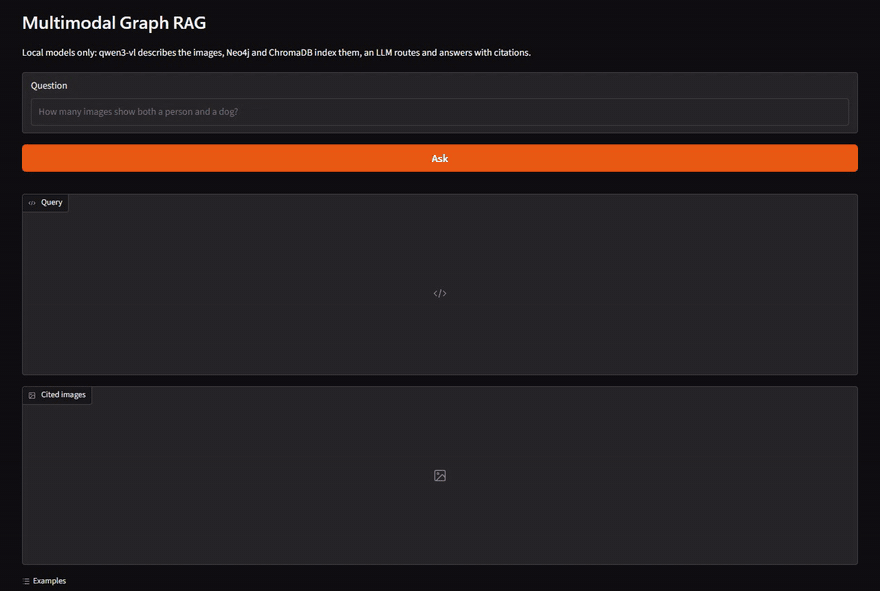

# multimodal-graph-rag

[](../../actions/workflows/ci.yml)

A multimodal Graph RAG that runs entirely on local models, measured against ground truth.
A vision-language model describes each photo; the descriptions feed a Neo4j graph (images,
objects, scenes) and a ChromaDB vector index; an LLM routes each question to the right
index, writes the Cypher query when needed, and answers with citations of the images it used.

The images and their annotations come from COCO 2017, so every stage can be scored: what the
VLM saw, which index a question went to, whether the LLM's query was right, and whether the
final count matches reality.



## Architecture


All models run through [Ollama](https://ollama.com): `qwen3-vl:8b` (vision), `mistral-small3.2`
(routing, Cypher, answers), `bge-m3` (embeddings). No external API.

Generated Cypher is checked before it runs (no `CREATE`, `MERGE`, `DELETE`, `SET`, `CALL`,
`LOAD CSV`...) and then executed in a **read transaction** with a 10 s timeout, so the database
itself refuses any write the check might miss.

## Results

490 COCO val2017 images (a seeded sample of 500; for 10 images the VLM returned no valid JSON,
see Limitations). Full details in [`results/`](results/).

| Stage | Metric | Result |
| --- | --- | ---: |
| VLM object extraction | precision / recall / F1 against COCO annotations (80 categories) | 0.86 / 0.88 / 0.87 |
| Router | questions sent to the right index (30 counting + 10 search) | 40 / 40 |
| LLM-written Cypher | counting answers equal to a reference query on the same graph | 30 / 30 |
| End to end | counting answers equal to the COCO count | 6 / 30 |
| End to end | counting answers within one image of the COCO count | 15 / 30 |
| End to end | median relative error of the count | 20 % |
| Semantic search | precision@5 (image relevant if COCO annotates the target object) | 0.94 |

Reading these numbers:

- **The LLM side is not the bottleneck.** Routing and query writing were right every time on
  this question set: the counting errors come entirely from the VLM's descriptions (the graph
  gives the same count as the generated query in all 30 cases).
- **Extraction errors add up in aggregates.** With 87 % F1 per image, a count over a few dozen
  images is rarely exact: the median error is 20 %, in both directions (13 counts too low, 11
  too high). The objects the VLM misses most are `dining table`, `truck` and `handbag`, often
  partly visible; it over-reports benches.
- So a statistic computed from VLM-built graphs needs either a better extractor or an
  uncertainty margin before it is reported to a user.
- **Keep the LLM's task small.** Asking it to return both the count and example image ids in
  one query made it write `UNION`s and undefined variables: 5 of the 30 queries failed. The
  prompt now asks for the count only, and the query that fetches the images to cite is derived
  by code from the validated query (same `MATCH`, new `RETURN`).

## Run

Requirements: Linux, Docker, Ollama with `qwen3-vl:8b`, `mistral-small3.2` and `bge-m3`, Python 3.11+.

```bash
python -m venv .venv && . .venv/bin/activate && pip install -e ".[dev]"
echo "NEO4J_PASSWORD=$(python -c 'import secrets; print(secrets.token_urlsafe(18))')" > .env
set -a; . ./.env; set +a
docker run -d --name mmgraphrag-neo4j -p 127.0.0.1:7474:7474 -p 127.0.0.1:7687:7687 \
  -e NEO4J_AUTH="neo4j/$NEO4J_PASSWORD" -v mmgraphrag-neo4j:/data neo4j:5.26

python -m mmgraphrag download   # 500 COCO images (annotations zip from cocodataset.org first, see below)
python -m mmgraphrag extract    # ~10 s per image on an RTX 5070 Ti, resumable
python -m mmgraphrag index      # Neo4j + ChromaDB
python -m mmgraphrag evaluate   # writes results/
python -m mmgraphrag app        # Gradio UI on http://127.0.0.1:7860
```

The COCO annotations (`annotations_trainval2017.zip`, CC BY 4.0) go to
`data/coco/annotations/`. Images are downloaded from the official COCO server and never
committed; the sample is fixed by a seed.

## Limitations

- **10 of 500 images were not described**: for them the VLM produced no parseable JSON, and
  retrying sent it into generation that did not stop. They are excluded from all metrics.
- **Template questions.** The 30 counting questions follow two templates (one object, two
  objects together). They test the pipeline end to end, not the variety of real user
  questions, and 30 questions give a coarse estimate.
- **COCO is an imperfect reference.** Annotations cover 80 categories only and sometimes miss
  objects; part of the measured "false positives" may be correct detections.

## Licence

MIT. COCO annotations: CC BY 4.0, images under their respective Flickr licences.
